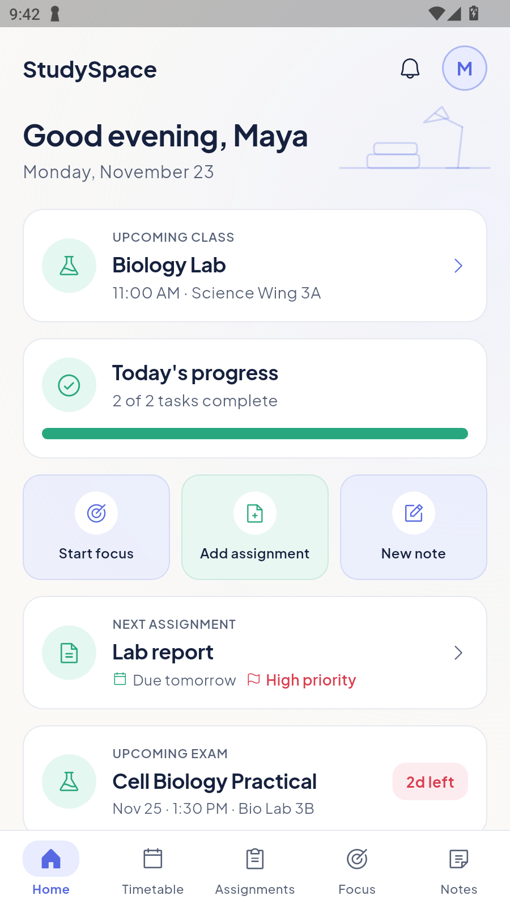
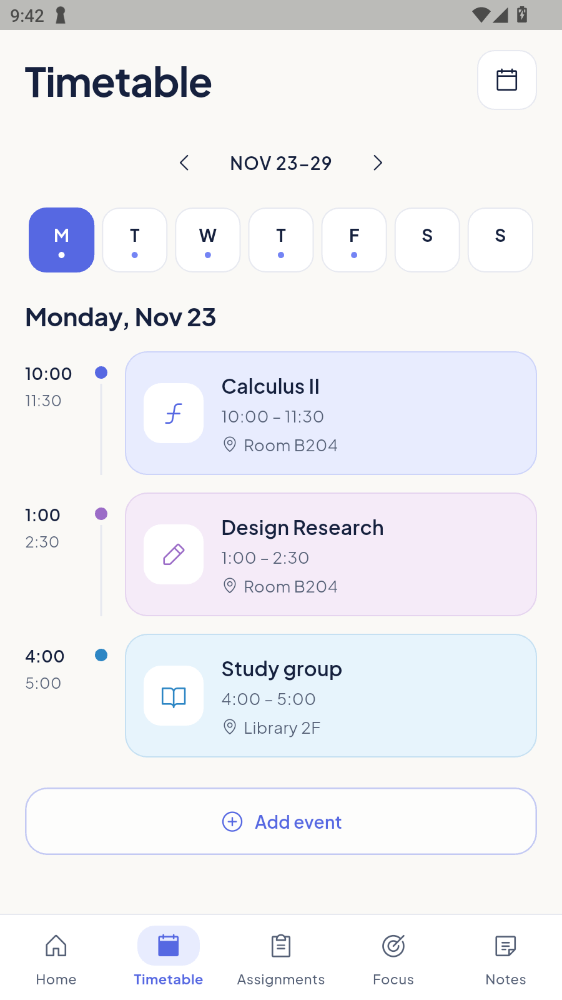
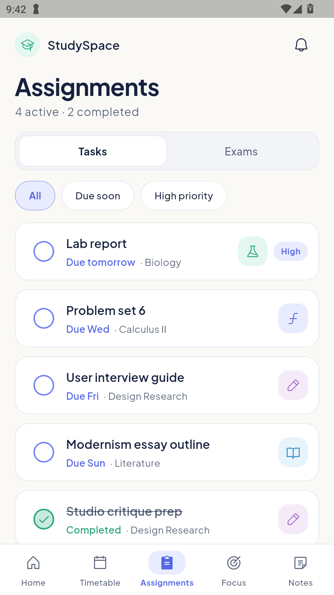
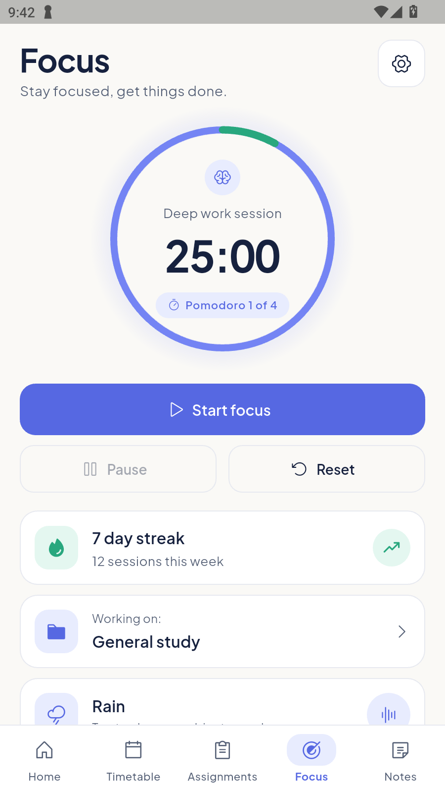
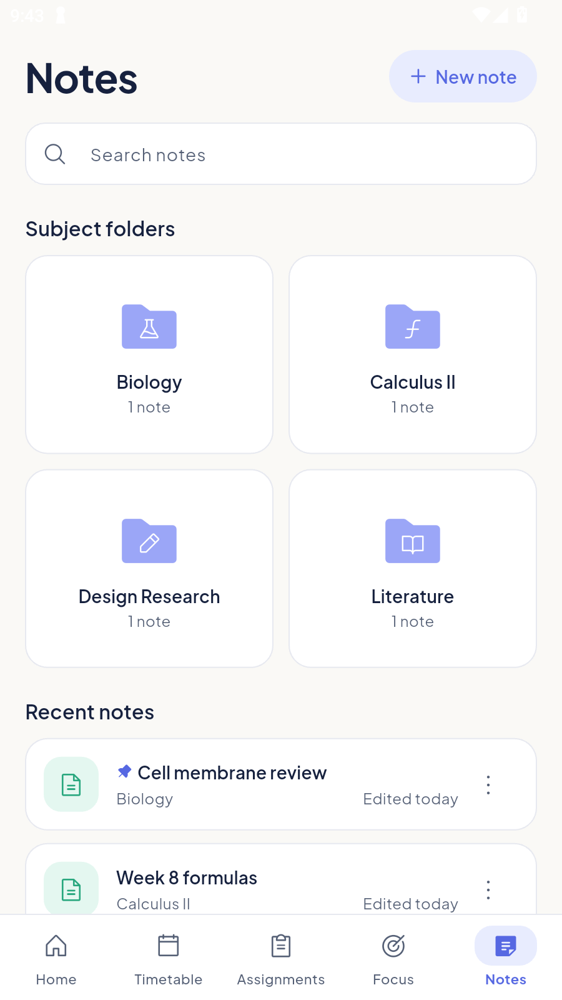
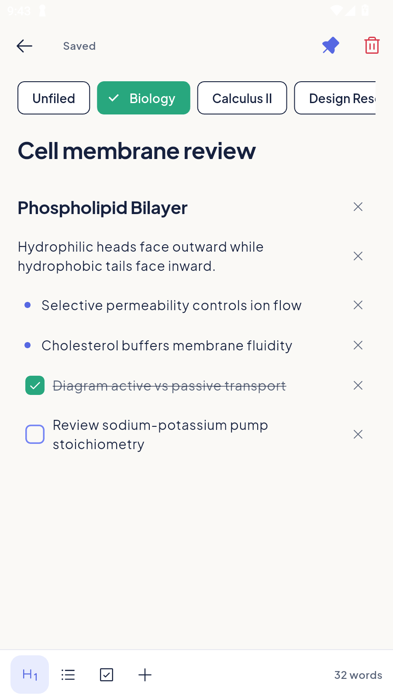
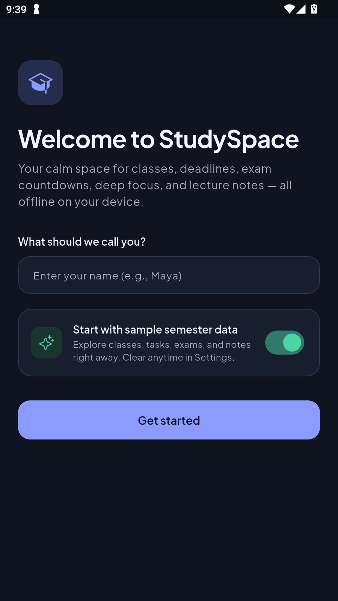
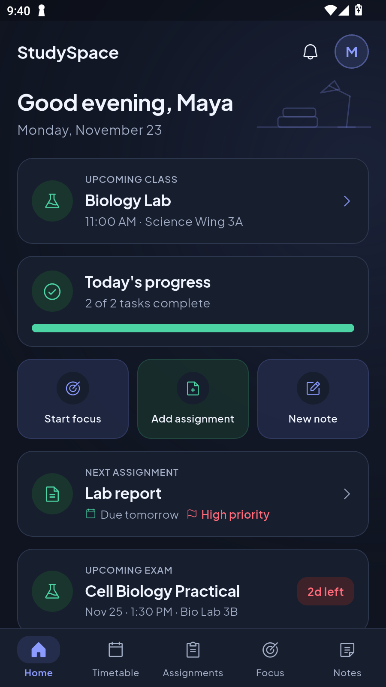
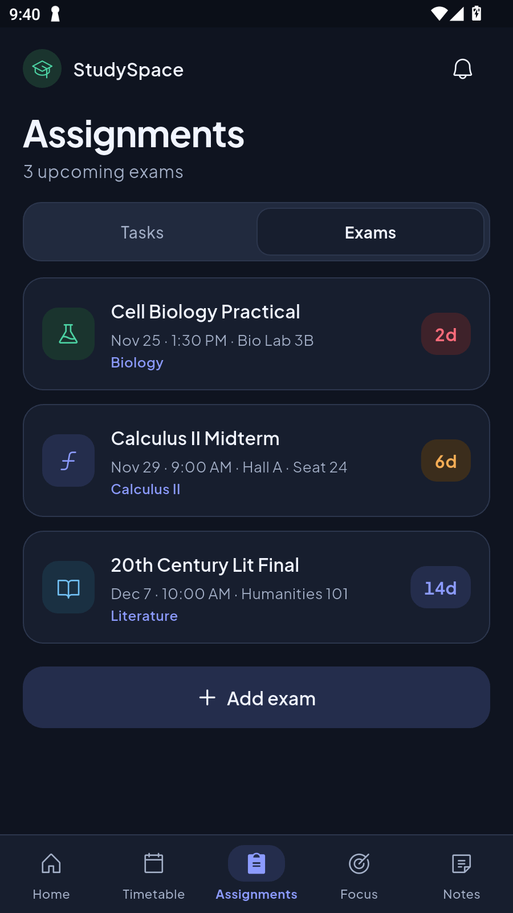

# StudySpace

**All-in-one offline-first university student companion for native Android and iOS.**

StudySpace brings class timetables, assignment deadlines, exam countdowns, a Pomodoro focus timer with lock-screen ambient audio, and subject-organized block notes into one calm, pastel interface — with full Light & Dark mode support and zero sign-up barrier.

---

## Download Android APK

Download and install the latest Android build directly from this repository:

- **Direct APK in repo:** [`releases/StudySpace-v1.0.0.apk`](releases/StudySpace-v1.0.0.apk)
- **GitHub Releases:** [StudySpace Releases](https://github.com/risterz/studyspace/releases)

> **Install on Android:** Download `StudySpace-v1.0.0.apk`, tap the file, and allow "Install from unknown sources" if prompted.  
> **iOS:** Standard iOS project files (`ios/`) are included and configured (`UIBackgroundModes: audio` and `UNUserNotificationCenter` delegate) for building via Xcode on macOS or cloud CI (Codemagic / GitHub Actions).

---

## Screenshots

### Light Mode

<table>
  <tr>
    <td align="center"><b>Home Dashboard</b><br/></td>
    <td align="center"><b>Weekly Timetable</b><br/></td>
    <td align="center"><b>Assignments</b><br/></td>
  </tr>
  <tr>
    <td align="center"><b>Focus Timer</b><br/></td>
    <td align="center"><b>Notes & Folders</b><br/></td>
    <td align="center"><b>Live Block Note Editor</b><br/></td>
  </tr>
</table>

### Dark Mode & Exam Countdown

<table>
  <tr>
    <td align="center"><b>Onboarding (Dark)</b><br/></td>
    <td align="center"><b>Home (Dark)</b><br/></td>
    <td align="center"><b>Exam Countdown (Dark)</b><br/></td>
  </tr>
</table>

---

## Features

- **Home Dashboard** — Time-aware greeting, subtle pastel desk-wash header accent, Upcoming Class card, Today's Progress bar, 3 Quick Actions (`Start focus`, `Add assignment`, `New note`), Next Assignment card, Upcoming Exam countdown card, and Upcoming Alerts bell sheet.
- **Class Timetable** — Week switcher (`< NOV 23–29 >`), 7-day strip with event dots, vertical color-coded timeline, recurring multi-weekday class series + one-off events, and jump-to-today control.
- **Assignments & Exam Countdown** — Unified `Tasks | Exams` switch keeping the 5-tab bar clean. Includes `All`, `Due soon`, and `High priority` filters, completion toggles with strikethrough, overdue detection, and chronological exam countdown pills (`14d`, `6d`, `2d`, `18h`) color-coded by urgency.
- **Focus Pomodoro Timer** — Glowing circular ring timer with tabular digits, drift-free timestamp recovery across background/screen lock, configurable Focus / Short Break / Long Break / Rounds settings, live streak & weekly session stats, task/subject linking, and offline looping ambient audio (**Rain**, **Cafe**, **White Noise**) with lock-screen media controls.
- **Notes Management** — Instant search across titles, body text, and subjects; 2x2 Subject folders grid; Recent notes with pin/move/delete; and a live block-based editor supporting styled headings, bullet lists, and directly tappable checklists stored as portable Markdown.
- **Shared Subjects & Settings** — Single subject catalog (custom pastel color + Phosphor vector icon) shared across all 5 tabs, safe unlink-on-delete, `System / Light / Dark` appearance switcher, notification lead-time settings, and sample semester demo loader.

---

## Architecture & Tech Stack

| Layer | Technology |
|---|---|
| Framework | Flutter `3.38.6` / Dart `3.10.7` (native Android & iOS) |
| State Management | `flutter_riverpod` |
| Navigation | `go_router` (`StatefulShellRoute.indexedStack`, locked 5-tab bar) |
| Local Database | `drift` + `sqlite3_flutter_libs` (offline SQLite, UUID PKs + soft-delete timestamps ready for future cloud sync) |
| Ambient Audio | `just_audio` + `audio_service` (Android Foreground Service + iOS `UIBackgroundModes: audio`) |
| Reminders | `flutter_local_notifications` + `timezone` (rolling 14-day scheduler capped at `<= 48` alerts for iOS ceiling safety) |
| Typography & Icons | Bundled offline `Plus Jakarta Sans` + `phosphor_flutter` vector icons |
| Future Monetization Seam | `EntitlementService` abstraction (free-all in v1, ready for Pro cloud sync / themes later) |

### Project Structure

```text
lib/
├── main.dart
├── app/
│   ├── app.dart                  # MaterialApp.router, Light/Dark ThemeMode, launch reminder sync
│   ├── router.dart               # GoRouter with /splash, /onboarding, locked 5-tab shell
│   ├── theme/                    # StudySpaceColors ThemeExtension (WCAG AA), ThemeData, subject styles
│   └── widgets/                  # StudyScaffold, PastelCard, SubjectBadge
├── core/
│   ├── db/                       # Drift 7-table schema, AppDatabase, SampleSeeder, providers
│   └── services/                 # NotificationScheduler, LocalNotificationService, BackgroundAmbientAudioService, EntitlementService
└── features/
    ├── onboarding/               # 1-step name + sample semester setup
    ├── home/                     # Dashboard, DeskWashPainter, UpcomingAlertsSheet
    ├── timetable/                # Weekly strip, timeline, recurring series editor
    ├── assignments/              # Tasks & Exams toggle, filters, countdowns, editors
    ├── focus/                    # Drift-free Pomodoro engine, FocusRingPainter, settings
    ├── notes/                    # Subject folders, search, live Markdown block editor
    └── settings/                 # Profile, appearance, Subject catalog CRUD, reminders, data tools
```

---

## Getting Started (Local Development)

### Prerequisites
- Flutter SDK `>= 3.38` (Dart `>= 3.10`)
- Android SDK (for Android builds/emulator) and/or Xcode on macOS (for iOS builds)

### Setup & Run

```bash
git clone https://github.com/risterz/studyspace.git
cd studyspace
flutter pub get
```

If you modify Drift tables in `lib/core/db/tables.dart`, regenerate `app_database.g.dart`:

```bash
dart run build_runner build --force-jit
```

Run static analysis and unit/widget tests (28 tests):

```bash
flutter analyze
flutter test
```

Run on a connected device or emulator:

```bash
flutter run
```

Build a release Android APK:

```bash
flutter build apk --release
```

---

## Credits

- **Font:** [Plus Jakarta Sans](https://fonts.google.com/specimen/Plus+Jakarta+Sans) (SIL Open Font License)
- **Ambient Audio:** Public-domain rainfall & cafe recordings from Wikimedia Commons (`Rain against the window.ogg`, `Restaurant ambience.ogg`), mastered into seamless offline stereo `.mp3` loops.
- **Icons:** [Phosphor Icons](https://phosphoricons.com/) via `phosphor_flutter`.
